# Vehicle Management System

A simple backend-focused Vehicle Management Web Application built using **Node.js**, the native **HTTP module**, **File System (FS) module**, and **Express.js**.

This project demonstrates how to create a basic web server, serve HTML pages, manage vehicle records, and build REST API routes using Express.js. Vehicle data is stored in JavaScript arrays, so no database setup is required.

## Project Overview

The application contains two server implementations:

1. **Native Node.js HTTP Server** — runs on port `3000`. It serves the HTML pages and provides routes to view and add vehicle records.
2. **Express.js Server** — runs on port `4000`. It provides REST API endpoints to create, read, update, and delete vehicle records.

## Technologies Used

- Node.js
- Express.js
- JavaScript (ES Modules)
- Native HTTP module
- File System (`fs`) module
- HTML
- npm

## Features

- Serves Home, About, and Info pages using the native HTTP server.
- Displays vehicle records in JSON format.
- Adds vehicle records through the native HTTP server.
- Provides Express REST API routes for:
  - `GET` — retrieve all vehicles or one vehicle by ID
  - `POST` — add a vehicle
  - `PUT` — update a vehicle
  - `DELETE` — delete a vehicle
- Includes screenshots of the server output and API operations.
- Uses an in-memory JavaScript array; data resets when the server restarts.

## Folder Structure

```text
MT-1-LabExam-main/
├── README.md
├── .gitignore
├── MT1_Lab_Exam_Vehicle_Management.pdf
└── VehicleManagement/
    ├── package.json
    ├── package-lock.json
    ├── httpServer.js
    ├── expressApp.js
    ├── public/
    │   ├── home.html
    │   ├── about.html
    │   └── info.html
    └── screenshots/
        ├── express-delete.png
        ├── express-get-1.png
        ├── express-get-all.png
        ├── express-post.png
        ├── express-put.png
        ├── express-running.png
        ├── http-about.png
        ├── http-home.png
        ├── http-info.png
        ├── http-running.png
        └── http-vehicles.png
```

## Requirements

Install the following before running the project:

- [Node.js](https://nodejs.org/) (which includes npm)
- A code editor such as Visual Studio Code
- A browser
- Postman or another API client (recommended for testing the REST API)

## How to Run the Project

### Step 1: Download or clone the repository

```bash
git clone YOUR_GITHUB_REPOSITORY_URL
```

Or download the ZIP file and extract it.

### Step 2: Open the project folder

Open the extracted `MT-1-LabExam-main` folder in Visual Studio Code.

### Step 3: Open the terminal in the VehicleManagement folder

```bash
cd VehicleManagement
```

### Step 4: Install dependencies

```bash
npm install
```

### Step 5: Run the native Node.js HTTP server

```bash
node httpServer.js
```

The server will start at:

```text
http://localhost:3000
```

Open these pages in your browser:

- Home: `http://localhost:3000/`
- About: `http://localhost:3000/about`
- Info: `http://localhost:3000/info`
- Vehicle records: `http://localhost:3000/vehicles`

### Step 6: Run the Express.js server

Stop the first server with `Ctrl + C`, or open a second terminal in the same `VehicleManagement` folder. Then run:

```bash
node expressApp.js
```

The Express server will start at:

```text
http://localhost:4000
```

## Express.js API Endpoints

Base URL: `http://localhost:4000`

| Method | Endpoint | Description |
|---|---|---|
| GET | `/vehicles` | Get all vehicle records |
| GET | `/vehicles/:id` | Get a vehicle by its ID |
| POST | `/vehicles` | Add a new vehicle |
| PUT | `/vehicles/:id` | Update a vehicle by its ID |
| DELETE | `/vehicles/:id` | Delete a vehicle by its ID |

### Example request body

Use this JSON body when sending a `POST` request to `/vehicles`:

```json
{
  "vehicleName": "Maruti Swift",
  "vehicleNumber": "UP14AB1234",
  "type": "Hatchback",
  "price": 750000
}
```

For a `PUT` request, send the updated vehicle details in JSON format to `/vehicles/:id`.

## Screenshots

The screenshots below show the application and API operations. They are stored in `VehicleManagement/screenshots/`.

### Native HTTP Server

| Output | Screenshot |
|---|---|
| Home page | 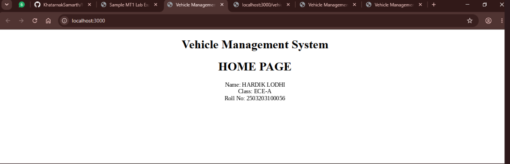 |
| About page | 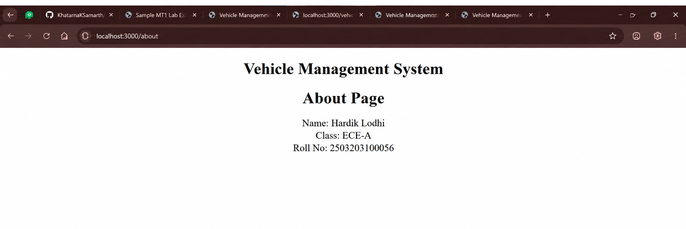 |
| Info page | 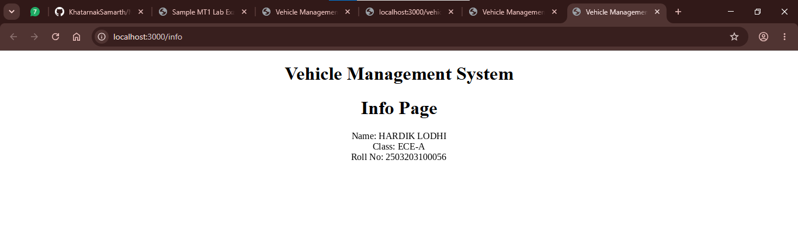 |
| Server running | 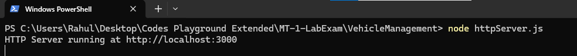 |
| Vehicle records | 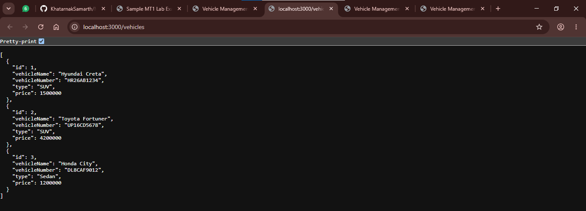 |

### Express.js REST API

| Operation | Screenshot |
|---|---|
| Express server running | 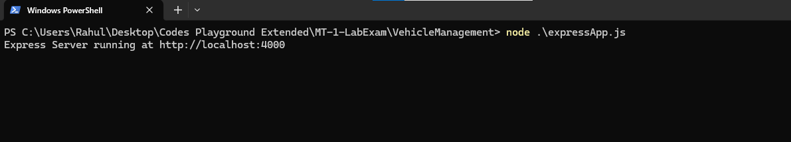 |
| Get all vehicles | 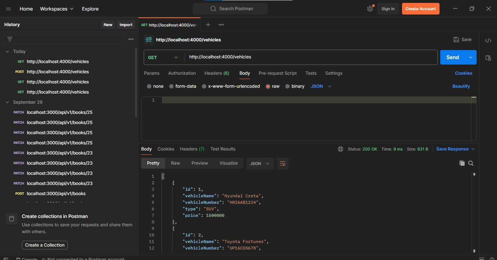 |
| Get vehicle by ID | 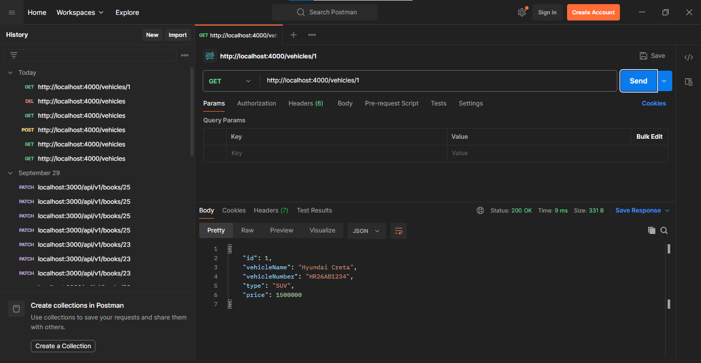 |
| Add vehicle | 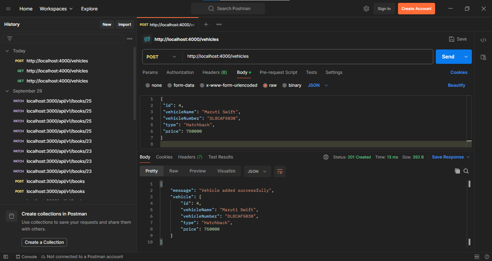 |
| Update vehicle | 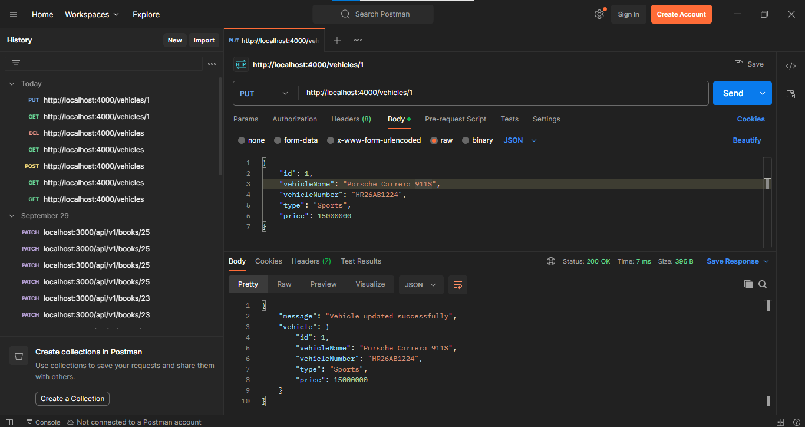 |
| Delete vehicle | 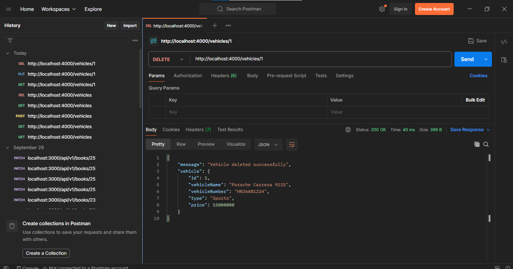 |

## Important Note

This is an educational lab project. Vehicle records are stored in memory using JavaScript arrays. The application does not use a database, authentication, or permanent data storage.

## Author

**Hardik Lodhi**  
B.Tech — Electronics and Communication Engineering  
ABES Engineering College
